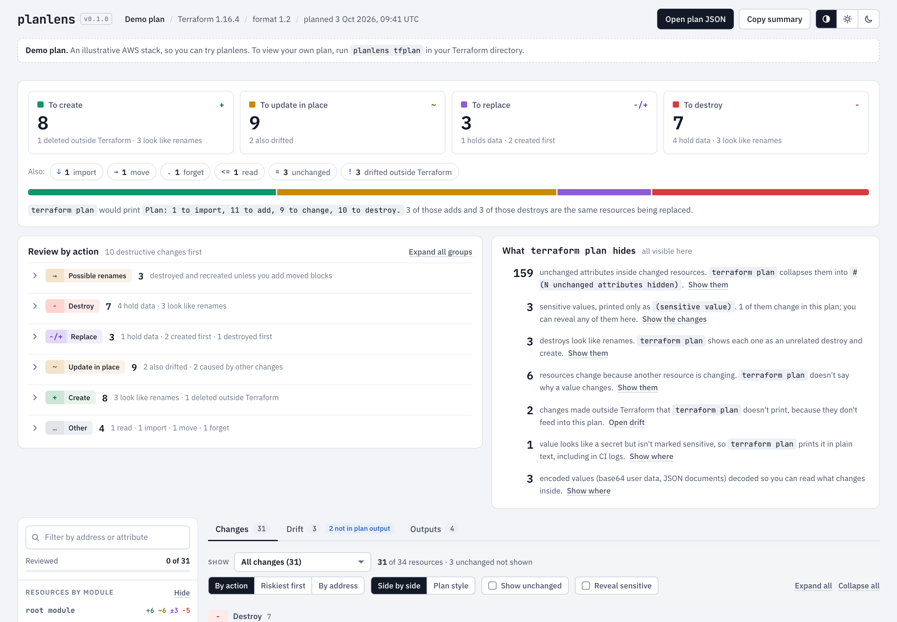
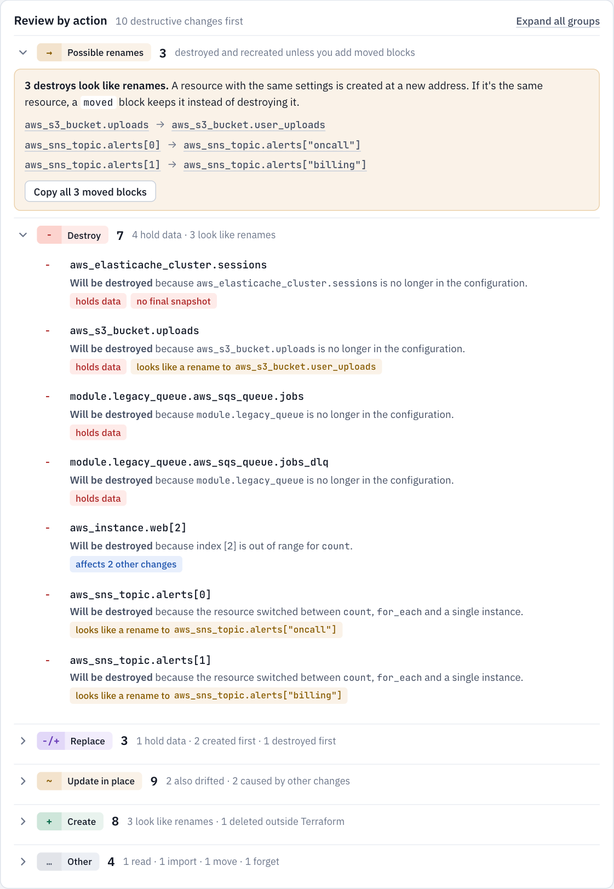
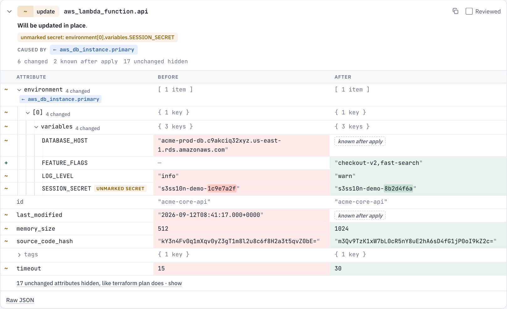
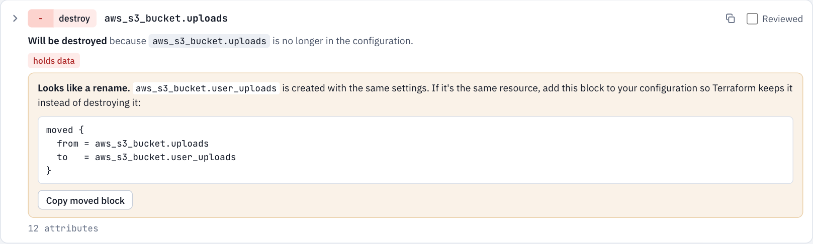
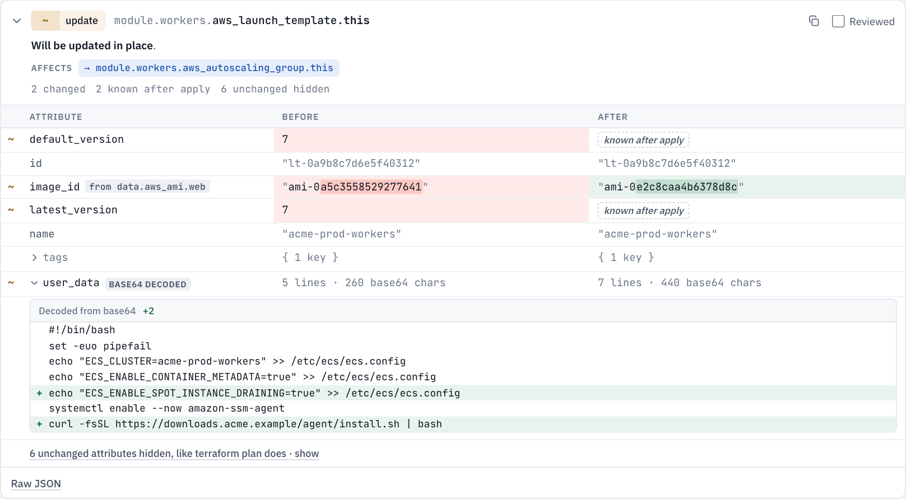

<p align="center">
  
</p>

<h1 align="center">planlens</h1>

<p align="center">
  See exactly what a Terraform or OpenTofu plan will create, update, replace and destroy,<br>
  including the parts <code>terraform plan</code> hides.
</p>

<p align="center">
  <a href="https://github.com/tarun9715m/terraform-planlens/actions/workflows/ci.yml"></a>
  <a href="https://github.com/tarun9715m/terraform-planlens/releases/latest"></a>
  <a href="https://tarun9715m.github.io/terraform-planlens/"></a>
  
  <a href="LICENSE"></a>
</p>

<p align="center">
  <a href="https://tarun9715m.github.io/terraform-planlens/"><b>Documentation</b></a> ·
  <a href="#install">Install</a> ·
  <a href="https://tarun9715m.github.io/terraform-planlens/guide/features">Features</a> ·
  <a href="https://github.com/tarun9715m/terraform-planlens/releases">Releases</a>
</p>

<picture>
  <source media="(prefers-color-scheme: dark)" srcset="docs/public/screenshots/overview-dark.png">
  
</picture>

## Why planlens

`terraform plan` is the last check before real infrastructure changes, and its text output makes that check hard:

- **Hidden values.** Unchanged attributes are collapsed. Sensitive values print as `(sensitive value)`, although `terraform show -json` stores them in plain text.
- **Mixed-up counts.** The summary line counts a replacement as both an add and a destroy, so you can't tell six replacements from six destroys.
- **Renames that destroy.** A rename without a `moved` block looks like an ordinary destroy and create, and destroys a database or bucket.
- **Unreadable values.** Base64 user data is two opaque blobs. Drift is often left out, and nothing says why a value changes.

planlens reads the plan's JSON and shows all of it in an interactive page that runs on your machine.

## Highlights

**Destructive changes first.** Every change is grouped by action, with data-loss warnings for resources that hold data, `skip_final_snapshot`, and replacements that destroy before they create.



**Full diffs that explain themselves.** Every attribute, side by side or in plan style. "Known after apply" is labelled, unmarked secrets are flagged, and each value shows which other change caused it.



**Renames caught before they destroy.** A destroy plus a create with the same settings is flagged, with the `moved` block that keeps the resource.



**Encoded values decoded.** Base64 user data, JSON policies and multi-line strings are diffed line by line, so a new `curl … | bash` line can't hide.



**Also:**
- sensitive values you can reveal one at a time;
- drift, including what `terraform plan` doesn't print;
- a Show filter, synced with the summary tiles;
- output changes;
- review progress;
- keyboard shortcuts;
- dark mode;
- [and more](https://tarun9715m.github.io/terraform-planlens/guide/features).

## Install

You need **Node.js 22 or newer** (`node --version`). Terraform or OpenTofu is needed only to read saved plan files.

```sh
npm install -g https://github.com/tarun9715m/terraform-planlens/releases/latest/download/terraform-planlens.tgz
planlens --version
planlens demo        # opens a sample plan in your browser
```

That installs the latest release. planlens has no runtime dependencies. For other ways to install, a fix for permission errors on Linux, and how to upgrade, see the [installation guide](https://tarun9715m.github.io/terraform-planlens/guide/installation).

## Quick start

```sh
cd path/to/your/terraform
terraform plan -out=tfplan
planlens tfplan
```

```text
planlens · tfplan · Terraform 1.16.4
  + 8 to create   ~ 9 to update   -/+ 3 to replace   - 7 to destroy
  ! 5 destructive changes to resources that hold data · 3 destroys look like renames

  Viewer: http://127.0.0.1:63548/af0749d2111a923f09d6fce678efcdf0/
  Served only to this computer. Press Ctrl+C to stop.
```

## Usage

```text
planlens <plan>                    Open the plan in your browser
planlens export <plan> [-o file]   Write a shareable HTML report, with secrets removed
planlens demo                      Open a demo plan
```

`<plan>` can be:
- a saved plan file;
- plan JSON from `terraform show -json tfplan > plan.json`;
- `-` to read plan JSON from stdin.

Useful options:

| Option | What it does |
|---|---|
| `--chdir <dir>` | Run Terraform in another directory |
| `--tofu` | Use OpenTofu |
| `--no-open` | Print the viewer address instead of opening a browser |
| `--port <n>` | Pick the viewer's port |
| `--include-sensitive` | Keep sensitive values in an exported report |

All options are in the [CLI reference](https://tarun9715m.github.io/terraform-planlens/guide/cli).

### Reports for pull requests and CI

```sh
planlens export tfplan -o planlens-report.html
```

The report is one HTML file anyone can open offline, with sensitive and secret-looking values removed. The docs show [how to attach it in GitHub Actions](https://tarun9715m.github.io/terraform-planlens/guide/ci).

## Privacy

- **The viewer stays on your machine.** It is served only to `127.0.0.1`, at a random URL, and refuses requests whose Host header isn't that address. Its content security policy blocks all network requests.
- **Nothing leaves your computer.** There's no account, no API key and no telemetry.
- **Reports are allow-listed.** They drop sensitive values, secret-looking values, configuration constants and variable defaults.

See [Privacy and security](https://tarun9715m.github.io/terraform-planlens/guide/privacy).

## Contributing

Issues and pull requests are welcome; see [CONTRIBUTING.md](CONTRIBUTING.md). To report a vulnerability, use [private reporting](https://github.com/tarun9715m/terraform-planlens/security/advisories/new) (see [SECURITY.md](SECURITY.md)).

```sh
git clone https://github.com/tarun9715m/terraform-planlens.git && cd terraform-planlens
npm ci
npm run dev      # the viewer with the demo plan
npm run check    # typecheck, tests and build
```

## License

[MIT](LICENSE). The viewer bundles IBM Plex Sans and JetBrains Mono under the SIL Open Font License 1.1.
